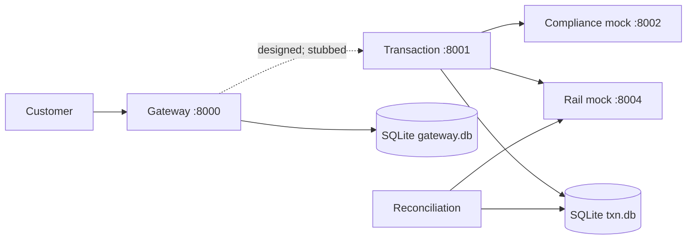

# Digital Wallet Enterprise Architecture

A university prototype of a SadaPay/NayaPay-inspired wallet-to-wallet transfer platform, focused on **transaction integrity, resilience and security**. All data is synthetic. This project is not affiliated with those companies and must not be used with real funds.

## Capabilities

- Idempotent transfer API with request-hash protection
- Double-entry ledger in integer paisa
- Guarded transaction state machine with audit history
- Compensation when the settlement rail rejects a transfer
- Compliance hold for large amounts (over PKR 400,000)
- Event deduplication and stuck-transfer recovery
- Ledger-to-rail reconciliation with an exception queue

## Architecture



| Component | Status |
| :--- | :--- |
| Gateway, Transaction Service, compliance and rail mocks, reconciliation | Implemented |
| Gateway-to-Transaction HTTP call | Stubbed: Gateway returns a simulated `DEBITED` result |
| Outbox dispatch | Events are persisted; delivery is not running |
| PostgreSQL and Docker Compose | Target architecture; not included in this baseline |
| AI fraud triage | Design only; advisory, cannot move money |

## Repository structure

```text
├── api/events/              # JSON event schema
├── data/seed/               # synthetic wallets
├── docs/
│   ├── adr/                 # architecture decision records
│   ├── architecture/        # C4, ERD, sequence and state diagrams
│   ├── contracts/           # OpenAPI, event catalogue and examples
│   ├── dossier/             # member design notes
│   └── submission/          # final submission documents
├── libs/common/             # clock, correlation, events, outbox
├── reports/                 # reconciliation output
├── scripts/                 # utility scripts
├── services/
│   ├── gateway/
│   ├── txn/
│   ├── compliance/
│   └── rail_mock/
├── tests/
├── AI_USE_LOG.md
└── requirements.txt
```

## Prerequisites

Python 3.13 (the version used for verification) and Git. Run all commands from the repository root. PowerShell commands are shown.

## Setup

```powershell
git clone https://github.com/mahnoorhamiid/ERP-wallet-project-v2.git
cd ERP-wallet-project-v2
python -m venv .venv
.\.venv\Scripts\Activate.ps1
pip install -r requirements.txt
$env:PYTHONIOENCODING = "utf-8"
```

On macOS/Linux activate with `source .venv/bin/activate`.

The repository contains a previously used `txn.db`. For a clean demonstration, stop all services and move it aside, then seed:

```powershell
Move-Item txn.db txn.previous.db
python -m services.txn.seed
```

This creates `W-DEMO001` (PKR 500,000.00) and `W-DEMO002` (PKR 100,000.00). Amounts in APIs are paisa.

## Run

Use one terminal per service, with the virtual environment active:

```powershell
python -m uvicorn services.gateway.main:app --port 8000
python -m uvicorn services.txn.main:app --port 8001
python -m uvicorn services.compliance.main:app --port 8002
python -m uvicorn services.rail_mock.main:app --port 8004
```

Interactive documentation: <http://127.0.0.1:8000/docs> and <http://127.0.0.1:8001/docs>.

Submit to the Gateway:

```powershell
$body = @{ sender_wallet_id="W-DEMO001"; receiver_wallet_id="W-DEMO002"; amount_minor=150000 } | ConvertTo-Json
Invoke-RestMethod -Method Post http://127.0.0.1:8000/v1/transfers -ContentType application/json `
  -Headers @{ "Idempotency-Key"="readme-demo-001"; Authorization="Bearer synthetic-token" } -Body $body
```

This demonstrates validation and idempotency. To post to the ledger, use the Transaction Service commands in the [demo script](docs/submission/04_Technical_Demo_Script.md).

## Test

Unit and contract tests (17 tests):

```powershell
pytest tests/test_events.py tests/test_idempotency.py tests/test_outbox.py -v
```

Ledger check (services stopped, `txn.db` moved aside; it writes to `txn.db`, so move that aside and seed again afterwards):

```powershell
python -m tests.test_ledger
```

Live scenarios, with all services running and the database seeded:

```powershell
python -m tests.scenarios.run_scenarios
```

Reconciliation for the current UTC date:

```powershell
python -m services.txn.recon --date (Get-Date).ToUniversalTime().ToString("yyyy-MM-dd")
```

### Known test issues

- Running bare `pytest` stops at collection: `scripts/test_api.py` needs the undeclared `requests` package, and `tests/scenarios/test_s01_idempotent_retry.py` has a shell command appended to its last line.
- `tests/test_ledger.py` requires an empty database.
- S04 in `run_scenarios.py` uses a hardcoded date and fails on other days. The reconciliation command above works.

## Configuration

| Variable | Default | Purpose |
| :--- | :--- | :--- |
| `DATABASE_URL` | `sqlite:///./txn.db` | Transaction database. Leave at default: the outbox table is tied to `txn.db` |
| `COMPLIANCE_URL` | `http://127.0.0.1:8002` | Screening service |
| `RAIL_URL` | `http://127.0.0.1:8004` | Rail mock |
| `IDEMPOTENCY_STALE_AFTER_S` | `30` | In-progress resume threshold |
| `RAIL_ALLOW_HEADER_OVERRIDE` | unset | Per-request rail mode when `1` |

## Documentation

- [Architecture Brief](docs/submission/01_Architecture_Brief.md)
- [Design Dossier](docs/submission/02_Architecture_Design_Dossier.md)
- [Architecture Review Deck](docs/submission/03_Architecture_Review_Deck.md)
- [Technical Demo Script](docs/submission/04_Technical_Demo_Script.md)
- [Evidence Pack](docs/submission/05_Engineering_Evidence_Pack.md)
- [Architecture decisions](docs/adr/)
- [AI Use Log](AI_USE_LOG.md)

## Limitations

This is a teaching prototype. Authentication is simulated, internal endpoints are unauthenticated and the mock rail loses its state on restart. The full limitations register and release gates are in the [Design Dossier](docs/submission/02_Architecture_Design_Dossier.md).
