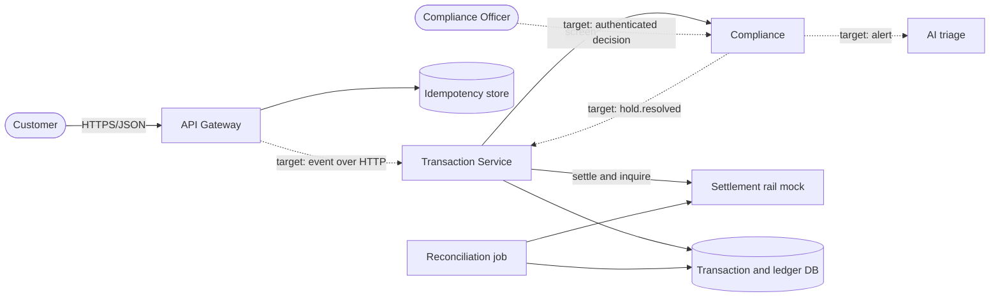
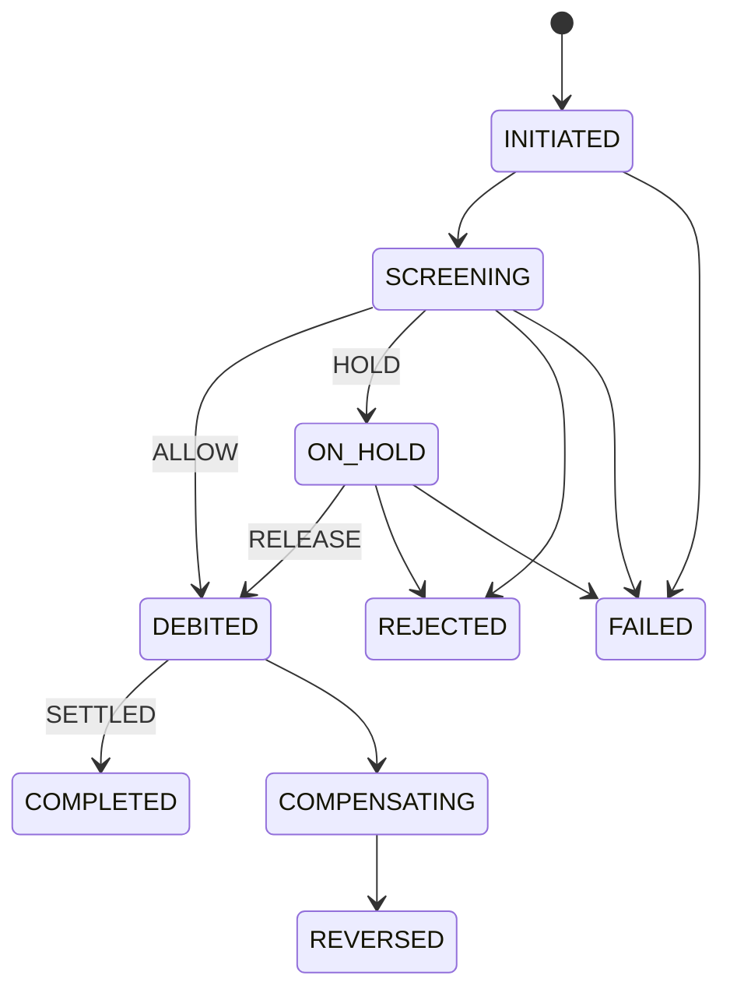
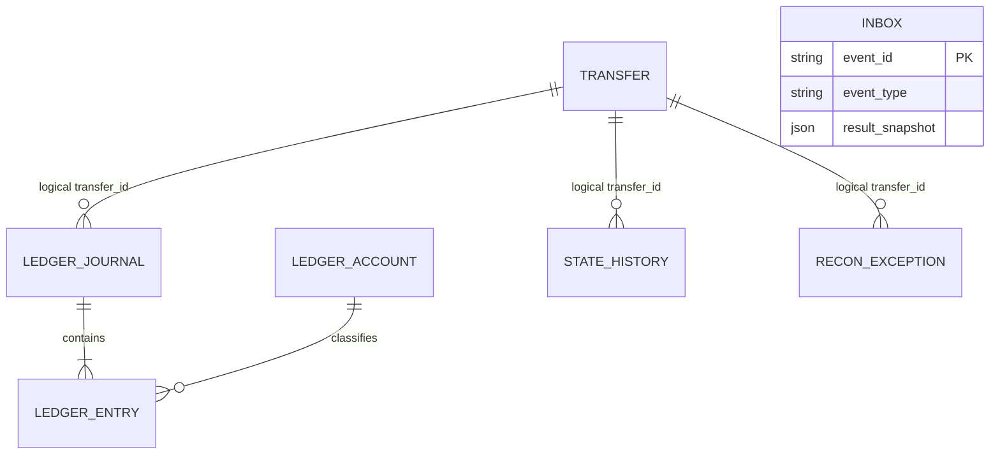

# Architecture and Design Dossier

## Digital Wallet Transaction Platform: Wallet-to-Wallet Transfer

**Team:** [M1], [M2], [M3], [M4] | **Baseline:** `f987b32` | **Data classification:** synthetic | **Verification date:** 2026-11-24

## 1. Introduction

### 1.1 Purpose

This dossier describes the architecture of a digital wallet inspired by Pakistani services such as SadaPay and NayaPay. It addresses one journey in depth: a customer transfers PKR from one wallet to another. The journey is small enough to implement in a university project, yet contains the central problems of financial engineering: duplicate instructions, distributed failure, controlled posting, compliance intervention and reconciliation.

The governing principle is **one instruction, one financial effect, one explainable outcome**. Availability matters, but the system must prefer a visible unresolved state to a fast and possibly wrong financial conclusion.

### 1.2 How to read implementation status

The dossier distinguishes the architecture from the evidence. Three labels apply throughout:

- **Built:** present and exercised in the repository.
- **Partial:** present but incomplete or simulated.
- **Target:** designed, without an implementation in the baseline.

Findings come from code inspection and from running the repository in an isolated copy on Windows 11 and Python 3.13. Section 12 assigns each material gap an identifier, such as L-04, that is referenced from the relevant section.

### 1.3 Architectural drivers

| Driver | Consequence |
| :--- | :--- |
| A retry must not create a second debit | Idempotency at Gateway, event inbox and journal leg |
| Money must remain explainable | Append-only double-entry journals and transition history |
| External settlement can be uncertain | Explicit intermediate state, inquiry, compensation, reconciliation |
| Compliance must precede posting | Fail-closed screening and human-resolved holds |
| AI must not move money | Advisory contract, isolated service, human authority |
| Results must be reproducible | Versioned contracts, synthetic seed, automated tests |

## 2. Architecture overview

### 2.1 C4 level 1: system context

The **Customer** initiates and monitors transfers. The **Operations Analyst** investigates reconciliation breaks. The **Compliance Officer** resolves held transfers. All three interact with the Wallet System. The Wallet System depends on an external **Settlement Rail**, represented here by a mock, for confirmation that a transfer settled.

The trust boundary surrounds the Wallet System. Customers and the rail sit outside it, so their messages must be authenticated, validated and considered repeatable. Staff are inside the organisation but still require individual identity and least privilege. The source diagram is `docs/architecture/c4_context.md`.

### 2.2 C4 level 2: containers

Solid lines represent calls exercised in the baseline. Dashed lines are target integrations.

- **API Gateway, partial.** Validates the public request, enforces idempotency and returns a correlation ID. It constructs a valid event but returns a simulated `DEBITED` response instead of calling the Transaction Service (L-01).
- **Transaction Service, built.** The sole component with authority to change transfer state or post to the ledger. It orchestrates screening, posting, settlement, compensation and recovery.
- **Compliance, mock.** Returns HOLD above 40,000,000 paisa (PKR 400,000), otherwise ALLOW.
- **Settlement rail, mock.** Supports success, rejection and timeout modes and stores results in memory.
- **Reconciliation job, built.** Compares debit journals with the rail report and opens exceptions.
- **AI triage, target.** Ranks alerts for human review (L-02).

Containers have independent processes and owners. The transaction and ledger models share a database so that a posting and its state transition can commit together. This is deliberate: splitting them would replace a local transaction with another distributed consistency problem.

### 2.3 C4 level 3: Transaction Service components

The event-ingestion endpoint receives an envelope and checks the inbox. A handler selects initiation, settlement or hold logic. The **state machine** validates the requested transition and reason, applies a compare-and-set update and appends history. The **ledger component** calculates balance and posts idempotent journals. The **outbox component** records a state-change message within the same database connection. The **recovery loop** periodically searches for `DEBITED` transfers that have not moved for more than ten seconds.

The main dependency direction is inward: transport handlers invoke domain operations, which use persistence. Compliance and rail adapters are currently direct HTTP calls inside the orchestration module. Extracting them behind interfaces is a maintainability improvement, not a precondition for the prototype.

### 2.4 BPMN process explanation

The process is a collaboration of five participants: Customer, Gateway, Transaction Service, Compliance and Settlement Rail.

1. The Customer's start event sends a transfer request. A Gateway task validates it.
2. An exclusive gateway tests whether the key is new, completed, active or conflicting. Completed requests follow the replay path and end. Conflicting and active requests end with an error.
3. For a new request, the Gateway sends `transfer.initiated`. This message flow is the target integration; the demonstration submits the event directly.
4. The Transaction Service creates the transfer and sends a screening request. A boundary error leads to FAILED with `SCREENING_UNAVAILABLE`.
5. An exclusive gateway evaluates the decision. REJECT ends the process. HOLD creates an intermediate wait for the Compliance Officer's message. ALLOW continues.
6. The service tests available balance and posts the debit leg. Insufficient funds should end as FAILED (L-06).
7. A settlement request is sent to the Rail. Success leads to the credit leg and COMPLETED.
8. Rejection enters a compensation subprocess: mark COMPENSATING, post the reversal, mark REVERSED.
9. A timer event represents uncertainty. The service inquires with the rail. The target process waits on an inconclusive response and escalates; the current code compensates (L-04).
10. A separate scheduled process runs reconciliation and creates human tasks for exceptions.

The BPMN distinction between an *error* and a *timeout* is important. A rejection is knowledge. A timeout is absence of knowledge.

## 3. Architecture decisions

| ADR | Decision | Principal trade-off |
| :--- | :--- | :--- |
| 001 | API-first OpenAPI contract | Export discipline is required |
| 002 | Client idempotency key and request hash | Lookup per request |
| 003 | Double-entry ledger | More complex queries |
| 004 | Compensation instead of two-phase commit | Funds may be in transit |
| 005 | Synchronous decision, asynchronous recovery | Hybrid behaviour to operate |
| 006 | Transactional outbox | Consumers must deduplicate |
| 007 | Derived balances and clearing account | Read cost and locking work |
| 008 | Relational idempotency store | Write latency and retention |
| 009 | Advisory AI with human authority | Manual decision effort |

ADRs 005 and 007 to 009 are proposed for team ratification. They refine rather than silently replace the earlier decisions.

Two-phase commit was excluded because an external rail is not expected to join the platform's database transaction. Keeping locks during a slow remote call would also expand failure and contention. Compensation accepts that history may contain a completed debit followed by a reversal. It preserves the facts and avoids pretending the debit never existed.

A full event-sourced architecture was also considered unnecessary. State history and journals give the required audit trail with simpler query behaviour. A broker would support more independent consumers at scale, but the prototype can establish delivery semantics with an inbox and outbox first.

## 4. Transaction state model

### 4.1 Business and technical states

The brief's business vocabulary maps to code as follows.

| Business meaning | Technical representation | Financial effect |
| :--- | :--- | :--- |
| Initiated | `INITIATED` | None |
| Authorisation in progress | `SCREENING` | None |
| Authorised | ALLOW recorded as the reason for `SCREENING → DEBITED`, or RELEASE for `ON_HOLD → DEBITED` | Posting follows in the same transaction |
| Posted | `DEBITED` with `DEBIT_LEG` | Sender reduced; clearing increased |
| Settled and completed | `COMPLETED` with `CREDIT_LEG` | Clearing cleared; receiver increased |
| Held | `ON_HOLD` | None |
| Declined | `REJECTED` or `FAILED` | None |
| Compensation in progress | `COMPENSATING` | Debit remains posted |
| Reversed | `REVERSED` with `REVERSAL_LEG` | Sender restored |

"Authorised" is a logical milestone instead of a separately persisted state. This reduces intermediate states but makes the transition reason part of the audit record. A production model that separates authorisation and debit in time should add `AUTHORISED` and an expiring funds reservation.

### 4.2 Allowed transitions

The transition map is a whitelist. An unknown edge or unapproved reason raises `IllegalTransition`. The update checks transfer identifier, expected state and version, then increments the version. A concurrent update therefore cannot overwrite a newer state unnoticed. The service retries the compare-and-set up to three times, and re-evaluates transition legality each time.

Terminal states are `COMPLETED`, `REVERSED`, `REJECTED` and `FAILED`. Terminal does not mean uninvestigable. An exception is handled through a linked record or a new compensating transaction, never by editing the old state.

### 4.3 Transaction invariants

1. Every journal's debit total equals its credit total.
2. Every entry amount is a positive integer in PKR paisa.
3. A transfer has at most one journal per leg.
4. A completed transfer has one debit and one credit leg.
5. A reversed transfer has one debit and one reversal leg.
6. Credit and reversal must never both exist for the same transfer.
7. A wallet must not fall below zero.
8. Every transition has a source event and timestamp.

Invariants 1 to 3 are implemented; the third is database-enforced. Invariants 4 to 6 follow from normal orchestration but need direct database checks and integration tests. Invariant 7 requires wallet serialisation (L-09). Invariant 8 is represented in state history.

### 4.4 Screening and hold semantics

Screening is fail-closed. A timeout or invalid screening response leads to FAILED before a debit. A HOLD also precedes the debit, and the test run confirmed that a held transfer did not change the balance. A hold release rechecks available balance because funds may have been spent since initiation.

The current hold contract calls for `decided_by`, but the Transaction Service accepts an untyped dictionary and does not enforce it. A synthetic decision without an officer was accepted during verification (L-11).

## 5. Integration contracts

### 5.1 Public API

`POST /v1/transfers` receives sender, receiver, integer amount, currency and optional reference. It requires `Authorization` and `Idempotency-Key`. Success returns HTTP 201 with the transfer identifier, status, correlation ID and timestamps.

| Condition | HTTP result |
| :--- | :--- |
| Missing idempotency key | 400 `MISSING_IDEMPOTENCY_KEY` |
| Missing or malformed bearer header | 401 `UNAUTHORIZED` |
| Same key, different body | 422 `IDEMPOTENCY_KEY_REUSED` |
| Same request still active | 409 `REQUEST_IN_PROGRESS` |
| Invalid amount, wallet pair or currency | 422 with a specific code |

The design also specifies `GET /v1/transfers/{id}` and `GET /v1/wallets/{id}/balance`. Those public routes are not implemented at the Gateway, although corresponding internal endpoints exist. Contract documentation must not advertise them as delivered. The committed OpenAPI file correctly exposes only the implemented transfer and health routes.

### 5.2 Internal API

| Endpoint | Producer / consumer | Semantics |
| :--- | :--- | :--- |
| `POST /internal/v1/events` | Gateway, Rail, Compliance → Transaction | Ingest command or external outcome |
| `POST /internal/v1/screen` | Transaction → Compliance | ALLOW, HOLD or REJECT; mock returns first two |
| `POST /rail/v1/settlements` | Transaction → Rail | Idempotent on transfer ID |
| `GET /rail/v1/settlements/{id}` | Transaction → Rail | Outcome inquiry |
| `GET /rail/v1/reports/settlements` | Reconciliation → Rail | Settlement records by date |

Remote calls from the Transaction Service use two-second timeouts. This bounds waiting but does not determine the remote result. Callers must not translate a transport exception into a business rejection.

### 5.3 Event contracts

Four version 1.0 event types are catalogued: `transfer.initiated`, `transfer.state_changed`, `rail.settlement_confirmed` and `hold.resolved`. The envelope carries event identity, type, version, occurrence time, producer, correlation ID, optional causation ID and typed data.

The shared Pydantic models reject unknown event types and malformed payloads. Thirteen example-based tests passed. The Gateway uses the model, but the Transaction Service currently receives a raw dictionary, so equivalent validation is not applied at its own boundary (L-07). The target endpoint should receive `EventEnvelope` directly. Producer authenticity must be verified separately: a well-formed event is not necessarily a trusted one.

Adding an optional field is a compatible change. Removing a field, altering meaning or making a field mandatory requires a new major version. Consumers should ignore compatible additional fields while rejecting unsupported major versions.

### 5.4 Idempotency contract

The Gateway's identity is `(client_id, idempotency_key)`. The body is converted to canonical JSON and hashed with SHA-256. Key order therefore does not alter the hash. A completed match returns the stored response. A conflicting body is rejected. An active request receives 409, while a record older than 30 seconds may resume with the same transfer and event identifiers.

Downstream, the inbox uses `event_id`. The ledger then provides a third barrier through the unique `(transfer_id, leg)` constraint. These protections operate at different boundaries: replay of an HTTP response, redelivery of an event, and repeated execution of a posting.

Two edge conditions remain. Concurrent first requests may collide on the Gateway's primary key without being translated to a clean 409. A redelivered event may encounter partially committed work because business effects and inbox insertion do not currently commit as one unit (L-08).

## 6. Data model

### 6.1 ERD explanation

- **Transfer** stores intent, parties, amount, current state, version and reconciliation flag.
- **Ledger Account** identifies a wallet or clearing account.
- **Ledger Journal** represents an atomic financial posting and identifies its transfer, leg and source event.
- **Ledger Entry** contains one directional amount within a journal.
- **State History** records each transition and reason.
- **Inbox** stores processed event identity and the returned snapshot.
- **Reconciliation Exception** stores expected and actual views and resolution status.
- **Outbox** stores state-change messages pending delivery.
- **Gateway Idempotency** is isolated in the Gateway database.

Foreign keys exist from entries to journals and accounts. Relationships from journal, history and exception to transfer are currently logical. Opening-balance journals intentionally have no transfer row, so a production schema should introduce an explicit operation or source entity instead of applying an unsuitable foreign key.

### 6.2 Ledger posting model

Wallet balances are liabilities: a credit increases the customer's claim and a debit reduces it. `CLEARING:OPENING` supplies synthetic opening balances. `CLEARING:SETTLEMENT` represents money between the sender's debit and final outcome.

| Posting | Debit | Credit |
| :--- | :--- | :--- |
| Opening | Opening clearing | Wallet |
| Debit leg | Sender wallet | Settlement clearing |
| Credit leg | Settlement clearing | Receiver wallet |
| Reversal leg | Settlement clearing | Sender wallet |

For a PKR 1,500 transfer, each posting uses 150,000 paisa. Sender and receiver change by equal and opposite amounts when completed, while settlement clearing returns to zero for that transfer. On reversal, the sender and clearing account each net to zero. Integer arithmetic avoids decimal representation errors.

### 6.3 Data constraints and retention

The unique transfer/leg constraint is the most important current relational control. Amount and direction checks reside in application code. The target PostgreSQL schema should add CHECK constraints, explicit clearing accounts, status constraints and database roles that deny update or delete on journal and entry tables.

The prototype does not define a validated legal retention period. The target policy requires confirmation from legal and compliance stakeholders before implementation. Idempotency records contain a 24-hour expiry value, but expiry is not enforced.

### 6.4 SQLite and PostgreSQL

SQLite supports the local demonstration. SQLAlchemy accepts an alternative database URL, but that alone does not establish portability. The baseline contains no PostgreSQL driver, migrations or Docker Compose. The outbox uses SQLite-specific connections and parameter markers, and the settlement account is not explicitly created, a gap that enforced foreign keys would expose (L-03). PostgreSQL is therefore a target, requiring implementation and tests before it may be presented as proven.

### 6.5 Synthetic data

The committed seed contains two generic wallets and no personal names, phone numbers or CNICs. Seeding establishes PKR 500,000 and PKR 100,000. The documented larger synthetic generator and automated data audit are not present. Demonstrations should therefore use the committed wallets and not claim the broader dataset.

## 7. Security architecture

### 7.1 Threat model

The main assets are ledger integrity, transfer authority, staff decisions, service credentials and audit evidence. Principal threats follow STRIDE.

| Threat | Scenario | Target response | Baseline |
| :--- | :--- | :--- | :--- |
| Spoofing | Caller impersonates a customer or officer | OIDC/JWT, MFA for staff, mTLS between services | Header presence only |
| Tampering | Altered amount or journal | Schema validation, restricted roles, append-only controls | Gateway validation; app convention |
| Repudiation | Officer denies release | Named identity and tamper-evident audit | Officer not enforced |
| Information disclosure | Logs expose personal data | Minimisation, encryption, log redaction | Synthetic data |
| Denial of service | Request flooding or slow rail | Quotas, circuit breaker, bulkheads | Timeouts only |
| Elevation | Internal endpoint used to inject settlement | Network policy and service authorisation | Open local endpoints |

### 7.2 Identity and authorisation

The target Gateway verifies signature, issuer, audience, expiry and scopes. `client_id` comes from the verified subject, and the sender wallet must belong to that subject. The current fixed `demo-client` is a placeholder. Any non-empty bearer value with the correct prefix is accepted.

Internal callers require workload identities and endpoint-specific permissions. The rail may submit settlement confirmations but not release holds. Compliance may resolve holds but not mark settlement. AI may do neither. Administrative rail endpoints are test-only and must not be deployed in a production topology.

### 7.3 Data protection and secure delivery

Target controls include TLS in transit, encryption at rest, managed secrets, short-lived credentials, minimal logging and tested backups. Build controls include dependency and secret scanning, image signing, branch protection and peer review. These are not claimed as implemented. The committed SQLite file contains test state but should be removed from source control in favour of repeatable seeding.

### 7.4 Compliance control integrity

The mock threshold demonstrates where a screening decision enters the process. It is not a substitute for sanctions screening, velocity analysis, customer risk scoring or a regulated monitoring platform. A production release should use separation of duties, reason codes and maker-checker approval for sensitive cases. Applicable State Bank of Pakistan requirements must be mapped with qualified stakeholders before any live use.

## 8. Resilience and recovery

### 8.1 Failure handling

| Failure | Intended behaviour | Baseline evidence |
| :--- | :--- | :--- |
| Duplicate HTTP request | Replay prior response | Passed against running Gateway |
| Duplicate completed event | Return inbox snapshot | Passed; one debit |
| Client loses response | Server completes; client resends same event | Passed after processing completed |
| Screening unavailable | Fail before posting | Code path inspected |
| Rail rejection | Reverse debit | Passed; net change 0 |
| Rail timeout, not found | Inquire, resolve, flag | REVERSED and flagged |
| Rail timeout, pending | Remain unresolved | Incorrectly REVERSED |
| Process stops in DEBITED | Recovery loop | Code path inspected; not crash-tested |

### 8.2 Compensation and ambiguity

Compensation is appropriate when the rail's failure is definitive. The unsafe case is an unknown result. The current code performs an inquiry after an exception but treats `PENDING`, `NOT_FOUND` and inquiry failure as sufficient reason to reverse. If settlement later succeeds, the sender has been refunded while external settlement also took effect. Reconciliation can detect some such differences, but detection is not prevention.

The target response is:

1. Keep the transfer in `DEBITED` and flag it when the outcome is unknown.
2. Poll using exponential backoff, jitter and a maximum age.
3. Compensate only after a contractual final rejection or verified cancellation.
4. Escalate aged exposure to Operations.
5. Quarantine a late settlement and open a critical exception.

A `NOT_FOUND` response is final only if the rail contract says that the original request can no longer be accepted. Otherwise, it may reflect delayed processing.

### 8.3 Crash consistency

The debit journal and `DEBITED` transition commit together. Settlement credit and completion also commit together in the standard path. This preserves two local atomic boundaries. Because no ledger transaction spans the rail call, recovery can resume from durable `DEBITED` state.

The recovery loop scans every 30 seconds, with a 10-second age threshold. It re-submits a transfer rather than inquiring first, relying on rail idempotency. The target loop should inquire first, use leased work claims to support multiple instances, isolate failures per transfer and avoid blocking the asynchronous event loop with synchronous HTTP.

### 8.4 Reconciliation

Reconciliation selects debit journals for a UTC date, loads transfers, requests the rail report and classifies differences.

| Break | Meaning |
| :--- | :--- |
| `MISSING_AT_RAIL` | Completed internally, absent externally |
| `MISSING_IN_LEDGER` | Reported externally, absent from selected ledger set |
| `AMOUNT_MISMATCH` | Reported altered amount differs |
| `STATUS_MISMATCH` | Internal and external outcomes conflict |

In verification, two tampered amounts and one deleted rail record produced the expected two amount and one missing-record breaks. The job writes JSON and CSV and creates an OPEN exception where the same break is not already open. It does not post adjustments.

The mock rail omits ordinary amounts from its report and adds an amount only when tampered, so the comparison does not yet represent a complete external settlement file. Transfers still in `DEBITED` are not classified, and the rail's in-memory store creates missing records on restart (L-12). The committed 2026-11-10 report contains seven missing-at-rail records and should be treated as historical evidence, not a clean outcome.

## 9. Observability and operations

### 9.1 Current evidence

The Gateway and Transaction Service expose health endpoints, and the Transaction Service checks database readiness. Gateway middleware accepts or generates a correlation UUID and returns it in `X-Correlation-ID`. Transfer rows and journals retain the event's correlation ID. State history provides a durable business trace.

This is useful but not distributed tracing. The middleware is installed only at the Gateway; services do not emit structured correlated logs; and the stub prevents end-to-end propagation (L-14). The OpenTelemetry API package appears in dependencies, but no exporter or instrumentation is configured.

### 9.2 Target telemetry

| Signal | Indicator | Example alert |
| :--- | :--- | :--- |
| Integrity | Unbalanced or duplicate legs | Any occurrence |
| Settlement | Oldest DEBITED transfer | Over 60 seconds |
| Compensation | Reversal rate and reason | Deviation from agreed baseline |
| Reconciliation | Open breaks by age and value | Any critical mismatch |
| Delivery | Oldest pending outbox event | Over 60 seconds |
| API | Latency, errors, replay rate | p95 above 2 seconds |
| Compliance | Hold queue age | Over agreed service level |
| AI | Abstention and override rate | Drift beyond approved limits |

Logs should contain timestamp, service, severity, correlation ID, transfer ID, event ID and outcome, while excluding tokens and personal data. Metrics must avoid customer or transfer identifiers as labels. Trace sampling must not determine audit retention; financial audit records remain durable independently.

### 9.3 Operational procedures

Runbooks are required for stuck transfer, rail outage, reconciliation break, compliance outage, database restore, suspected duplicate and AI disablement. Each should define detection, owner, safe queries, permitted actions, escalation and closure evidence. Direct balance edits are prohibited. Corrections require approved compensating journals.

### 9.4 Outbox operation

State changes append an event to the outbox on the same database connection. The unit test confirms enqueue and a simulated status update. The running service does not start the dispatcher, and the dispatch function prints and assumes success without making an HTTP request. During verification, outbox rows remained PENDING (L-10). ADR-006 is therefore implemented for event capture, not for at-least-once delivery.

## 10. AI governance

### 10.1 Bounded purpose

The target AI function triages fraud alerts for a human officer. It may propose priority, explain supplied signals and recommend review. It may not approve, reject, release, reverse, post or alter a transfer. The AI service is optional: failure leaves alerts in the ordinary queue and the transaction path operational.

The service, tests and network configuration described in the M4 design note are **not present in the baseline**. This section is a governance specification, not implementation evidence.

### 10.2 Decision workflow

1. Compliance creates an alert with minimised synthetic features.
2. AI returns recommendation, confidence, rationale and version.
3. Confidence below 0.70 produces `ABSTAIN`.
4. The officer reviews source evidence, not only the AI summary.
5. The officer authenticates and records RELEASE or REJECT with a reason.
6. Compliance emits a signed `hold.resolved` attributable to that officer.
7. The Transaction Service verifies producer, officer authority, state and funds.
8. The decision and any AI override are retained for review.

The AI has no credential that can perform steps 5 to 7. Network policy and authorisation both enforce this, so failure of one barrier does not grant money authority.

### 10.3 Risk controls

| Risk | Control |
| :--- | :--- |
| Automation bias | Show evidence first; require a reason; sample decisions |
| Prompt injection | Treat alert text as data; no tools; structured output validation |
| Hallucinated rationale | Cite supplied fields only; human verification |
| Bias or drift | Evaluate by synthetic cohort and scenario; monitor overrides |
| Privacy | Synthetic data; minimised payload; no unnecessary identifiers |
| Duplicate alerts | Deduplicate on alert ID; preserve recommendation version |
| Outage | Manual queue; kill switch; no default release |

### 10.4 Evaluation

Before activation, the team must create a labelled synthetic test set and agree acceptance thresholds. Measures include high-risk recall, precision, calibration, abstention and human-override rates. An arbitrary confidence number is not a calibrated probability, so the 0.70 threshold must be tested against observed outcomes. Version approval, rollback and periodic human review form part of change control.

## 11. Verification summary

| Evidence | Result |
| :--- | :--- |
| Event contracts | 13 passed |
| Idempotency store unit tests | 3 passed |
| Outbox unit test | 1 passed |
| Gateway retry scenario | 3 passed only after removing a stray command; file fails as committed |
| Ledger script | Passed on empty DB; failed on committed DB |
| Normal transfer | COMPLETED with equal and opposite wallet changes |
| Rail rejection | REVERSED, net 0 |
| Duplicate event | One debit, prior snapshot returned |
| Compliance hold | ON_HOLD, balance unchanged |
| Reconciliation with current date | Injected breaks detected |
| Unbalanced-journal query | 0 rows |
| PostgreSQL, Docker, AI, load and failover | Not verified |

Passing unit tests do not establish the full system property. The release test suite must run the complete Gateway-to-ledger flow, concurrent requests, crash points, duplicate delivery before and after commit, uncertain settlement, officer authorisation and database constraints.

## 12. Limitations and release gates

### 12.1 Limitations register

"Run" means reproduced during verification; "code" means identified by inspection.

| ID | Limitation | Basis | Severity | Exit criterion |
| :--- | :--- | :--- | :--- | :--- |
| L-01 | Gateway result is stubbed | Code | High | End-to-end HTTP scenario passes |
| L-02 | AI service and its tests absent | Run | High | Isolated service and tests committed |
| L-03 | Docker and PostgreSQL path absent | Run/code | High | Clean Compose run and PostgreSQL suite pass |
| L-04 | Inconclusive rail outcome is reversed | Run | Critical | Pending remains unresolved; late-settlement test passes |
| L-05 | `REJECTED` settlement callback can complete a `DEBITED` transfer | Run | Critical | Status and producer validated; reversal tested |
| L-06 | Insufficient funds returns HTTP 500 because rollback removes the transfer | Run | High | Durable FAILED result; no posting |
| L-07 | Transaction boundary lacks typed validation; self-transfer and unknown receiver accepted | Run | High | Typed events and active-wallet tests |
| L-08 | Inbox and business effects are not atomic | Code | High | Crash and concurrent-redelivery tests pass |
| L-09 | Wallet debit lacks serialisation | Code | High | PostgreSQL overspend race test passes |
| L-10 | Outbox delivery is not operating | Run | High | Retrying delivery and failure handling pass |
| L-11 | Identity, internal authorisation and officer identity absent | Run/code | Critical | Negative security suite passes |
| L-12 | Rail and reconciliation coverage incomplete | Run/code | Medium | Durable rail and full amount/status report |
| L-13 | Test suite is not clean or repeatable | Run | Medium | Bare `pytest` passes from clean clone |
| L-14 | End-to-end tracing and structured logging absent | Code | Medium | Correlated journey across services |

### 12.2 Release gates

- **Gate 1, financial integrity:** close L-04 to L-09 and L-13. Add wallet locks, callback validation and crash tests.
- **Gate 2, integration:** close L-01, L-03, L-10 and L-12. Demonstrate PostgreSQL in Docker.
- **Gate 3, security:** close L-11. Complete threat-model and penetration review.
- **Gate 4, operations:** close L-14. Pass load, failover, backup-restore and runbook exercises.
- **Gate 5, AI:** close L-02. Pass isolation, abstention, evaluation and human-approval tests. This gate may be omitted if AI remains disabled.

### 12.3 Conclusion

The architecture places financial authority in one bounded service, represents in-flight money explicitly and records outcomes through a balanced ledger and controlled state machine. The demonstrated duplicate, compensation and reconciliation scenarios provide credible evidence for the architectural direction.

The baseline is nevertheless a prototype. Ambiguous settlement, callback validation, identity and transaction atomicity are financial or security blockers, not finishing touches. The recommendation is **Go for a synthetic academic demonstration, Conditional Go for a controlled synthetic pilot after Gates 1 and 2, and No-Go for real funds until every applicable gate is evidenced**.

## Appendix A. Traceability

| Requirement | Dossier section | Repository source |
| :--- | :--- | :--- |
| Architecture decisions | 3 | `docs/adr/` |
| State model | 4 | `services/txn/state_machine.py` |
| Integration contracts | 5 | `docs/contracts/`, `libs/common/events.py` |
| Data model | 6 | `services/txn/models.py` |
| Security | 7 | `services/gateway/routers/transfers.py` |
| Resilience | 8 | `services/txn/main.py` |
| Reconciliation | 8.4 | `services/txn/recon.py` |
| Observability | 9 | `libs/common/correlation.py` |
| AI governance | 10 | `docs/dossier/M4_ai_bounded_design.md` (design) |
